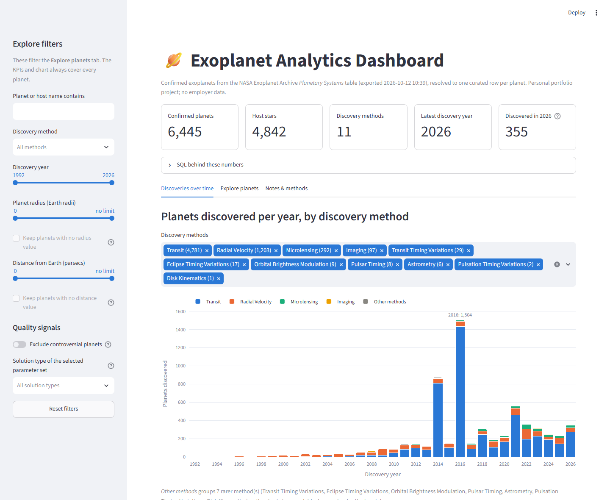

# 🪐 Exoplanet Analytics Dashboard

An interactive dashboard over the public NASA Exoplanet Archive. A small ETL pipeline loads
every published parameter set (~40,000 rows) into SQLite, a documented data-quality rule
resolves them to one trustworthy row per planet (~6,400 planets), and a Streamlit app reports on
the result: headline KPIs, discoveries over time, self-service filtering, and a drill-down to
every source measurement behind each planet.

**Live demo:** _add the Streamlit Community Cloud link here once deployed_



> **Personal portfolio project.** Not affiliated with, and uses no data from, any employer or
> client. All data is public, from the NASA Exoplanet Archive.

## Features

- **Overview KPIs:** confirmed planets, host stars, discovery methods, latest discovery year,
  and planets discovered that year.
- **Discoveries over time:** stacked bar chart of planets per year by discovery method, with a
  method filter, hover breakdowns, and the underlying data table.
- **Explore planets:** a filterable table (name, method, year, radius, distance, controversial
  flag, solution type) with CSV download. Selecting a planet opens a detail view with its
  curated values, the study they came from, and every competing parameter set ranked by the
  selection rule.
- **Notes & methods:** the data source, the selection rule in plain language, and known caveats.
- **Visible SQL:** every view has a "SQL behind this" expander showing the exact query it ran.

## Stack

Python 3.11+ · pandas · SQLite (`sqlite3`) · Streamlit · Plotly

## How it works

### Pipeline: `build_database.py`

1. **Extract.** The Planetary Systems (PS) table, downloaded from the archive as CSV into
   `data/PS.csv`.
2. **Transform.** pandas skips the leading `#` metadata block, coerces numeric columns
   (`pd.to_numeric(errors="coerce")`), stores flags, counts and years as integers, and trims text.
3. **Load.** Every row and every column (including all `*err1`/`*err2` uncertainty columns) goes
   into the raw `planet_params` table, with a surrogate key `param_set_id`.
4. **Select.** A SQL window function picks one row per planet into the curated `planets` table.

The script drops and rebuilds everything on each run, checks that required columns exist (and
fails with a clear message if the archive renames one), verifies exactly one curated row per
planet, and prints a summary.

### Data model

| Table | Grain | Role |
|---|---|---|
| `planet_params` | one row per published parameter set | Raw, faithful copy of PS. Powers the drill-down. |
| `planets` | one row per planet | Curated layer: same columns plus `disc_decade`, `completeness`, `selection_score`, `n_param_sets`. Powers the main views. `param_set_id` links each planet back to its source row. |
| `build_info` | key/value | Source file, archive export timestamp, build time. |

### The one-row-per-planet rule

PS stores one row per study, so each planet appears several times (up to 34). Each row is
internally consistent (all values from one study), which is why this project uses PS rather than
the archive's stitched-together composite table. For each planet:

1. **Completeness first.** Score each row by how many of nine study-dependent fields it fills:
   orbital period, semi-major axis, radius, mass, insolation, equilibrium temperature, stellar
   temperature, stellar radius, stellar mass. Radius and mass count double (max score 11).
2. **Then recency.** Ties go to the most recently published study (`pl_pubdate`), then the
   archive's `rowupdate`/`releasedate`, then NASA's `default_flag`, then file order.
3. **Nobody is dropped.** A sparse planet keeps its best available row.

```sql
ROW_NUMBER() OVER (
    PARTITION BY pl_name
    ORDER BY selection_score DESC,
             COALESCE(substr(pl_pubdate, 1, 10), substr(rowupdate, 1, 10), substr(releasedate, 1, 10)) DESC,
             rowupdate DESC, releasedate DESC, default_flag DESC, param_set_id
)
```

### Data-quality findings

- **NASA's default row is often not the most complete.** The rule picks a different row than
  `default_flag` for 3,498 of 6,445 planets (54%), raising the average number of filled key
  fields from 5.8 to 7.2.
- **A parsing trap.** The CSV's metadata lines start with `#`, but 55 data rows also contain `#`
  inside HTML entities in author names (e.g. `&#x131;`). `read_csv(comment="#")` silently
  truncates those rows, which leaves some planets looking completely empty. The pipeline skips
  only the leading metadata block instead.
- **Pipeline catalogs are very complete but never include mass.** About 2,700 planets' chosen
  row comes from a Kepler (KOI) or TESS pipeline solution. These are flagged by solution type
  and filterable in the app.

The app's Notes tab lists the full set of caveats.

## Run locally

```bash
python -m venv .venv
.venv\Scripts\activate          # macOS/Linux: source .venv/bin/activate
pip install -r requirements.txt
python build_database.py
streamlit run app.py
```

The app also builds `exoplanets.db` by itself on first run if the file is missing, which is how
the hosted version works.

### Refreshing the data

Download the [Planetary Systems table](https://exoplanetarchive.ipac.caltech.edu/cgi-bin/TblView/nph-tblView?app=ExoTbls&config=PS)
as CSV (all columns), save it as `data/PS.csv`, and rerun `python build_database.py`.

## Project structure

```
app.py                Streamlit app (KPIs, chart, Explore + drill-down, Notes)
build_database.py     ETL: CSV -> SQLite raw + curated tables
data/PS.csv           NASA Exoplanet Archive PS export
docs/screenshot.png   README screenshot
requirements.txt
.streamlit/config.toml
```

## Roadmap

- **Phase 2:** a `stars` table with JOIN-powered views, property scatter plots (mass vs. radius,
  photometric colors), a data-completeness panel, more filters.
- **Phase 3:** field-level composite values with per-value source lineage, automated extract via
  the archive's TAP API, an "Earth-like" subset view, and a variable-star light-curve module.

## Data credit

This project uses the [NASA Exoplanet Archive](https://exoplanetarchive.ipac.caltech.edu/),
which is operated by the California Institute of Technology under contract with NASA under the
Exoplanet Exploration Program.
